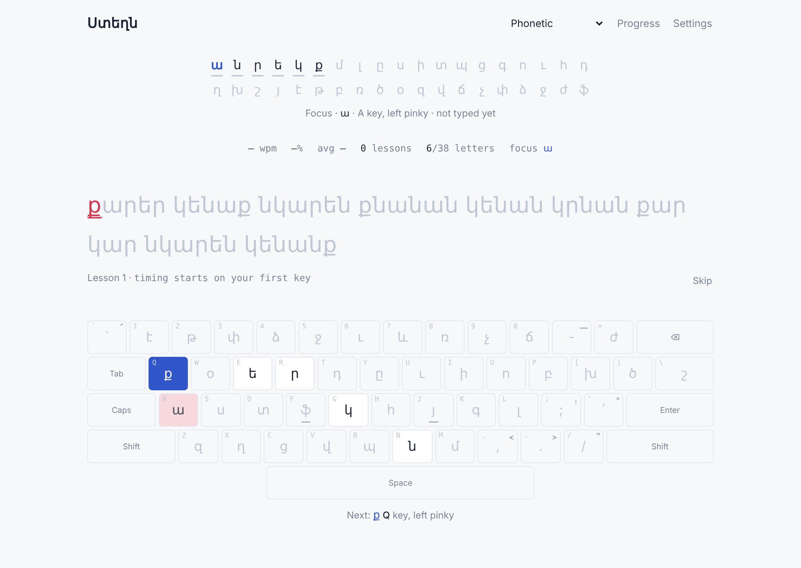

# Ստեղն

**Touch typing for Western Armenian.** An adaptive trainer in the style of [keybr.com](https://www.keybr.com): you start with a few letters, practise on real Western Armenian words, and unlock new letters as your speed improves.



## Features

- **Adaptive lessons.** You start with six letters. Each lesson leans toward your slowest letter (your *focus* letter). Once every letter you have reaches your target speed, the next one unlocks.
- **Real words.** About 2,900 Western Armenian word forms in classical spelling. Lessons use real words whenever your unlocked letters allow, and no word appears more than twice in one lesson. Made-up words only fill in when real ones run out.
- **Four keyboard layouts**, each with its own saved progress:

  | Layout | Notes |
  |---|---|
  | **Phonetic** | Letters by Western Armenian sound (պ on B, բ on P, տ on D, դ on T, կ on G, գ on K) |
  | **Eastern phonetic** | Microsoft's default *Armenian Phonetic* layout (Eastern sounds) |
  | **Western legacy** | Windows *Armenian Western (Legacy)* |
  | **Eastern legacy** | Windows *Armenian Eastern (Legacy)* |

- **No Armenian keyboard needed.** The page reads physical key positions and turns them into Armenian letters. If your computer already types Armenian, that works too.
- **On-screen keyboard** that shows the next key and which finger to use.
- **Per-letter stats** and a speed chart across lessons.
- **Options:** target speed, capital letters, punctuation (։ ,), stop on mistakes, show or hide the keyboard and Latin labels.
- **Backups:** save all your progress as a `.json` file and load it on another device or browser.
- Light and dark mode, and it works on phones.

## How the letters unlock

Letters unlock in an order chosen to give you as many real words as possible as early as possible:

```
ա ն ր ե կ ք մ լ ը ս ի տ պ ց գ ո ւ հ դ ղ խ շ յ է թ բ ռ ծ օ զ վ ճ չ փ ձ ջ ժ ֆ
```

A letter counts as learned once you have typed it at least 10 times and its average speed is at or above the target. You can also unlock or remove letters by hand in **Settings**.

## Your data

Progress saves automatically in your browser's local storage, separately for each layout. It stays on that browser and that site address only, and it is lost if you clear site data.

To keep it safe or move it, open **Settings**:

- **Save backup (.json)** downloads a file like `steghn-backup-2026-10-22.json`.
- **Load backup…** restores from that file after asking for confirmation.

Nothing is sent to a server.

## Host it on GitHub Pages

1. Create a new repository on GitHub, for example `steghn`.
2. Upload the contents of this folder (`index.html`, `README.md`, `docs/`, `tools/`) to the root of the `main` branch.
3. In the repository, go to **Settings → Pages**.
4. Under **Build and deployment**, set **Source** to **Deploy from a branch**, choose `main` and `/ (root)`, then click **Save**.
5. After a minute or two the site is live at `https://<your-username>.github.io/<repository-name>/`.

Or from the command line:

```bash
git init
git add .
git commit -m "Ստեղն typing trainer"
git branch -M main
git remote add origin https://github.com/<your-username>/<repository-name>.git
git push -u origin main
```

Then turn on Pages as in steps 3 and 4.

> Progress is stored per site address. If you move the trainer to a different URL, use **Save backup** on the old address and **Load backup** on the new one.

## Run it locally

Everything is in one file. Open `index.html` in a browser, or serve the folder:

```bash
python3 -m http.server 8000
# then open http://localhost:8000
```

The only outside request is to Google Fonts. Without internet the page still works, in your system fonts.

## Project structure

```
index.html            The whole app: markup, styles, layouts, word list and logic
docs/screenshot.png   Screenshot used in this README
tools/build_words.py  Generates the word list and writes it into index.html
README.md
```

## Editing the word list

The vocabulary is generated by `tools/build_words.py`. It contains about 650 hand-written base words and expands them with regular grammar:

- **Nouns:** definite form and plural (տուն → տունը, տուներ, տուները)
- **Verbs:** present forms (գրեմ, կարդամ, խօսիմ…) and regular past forms (գրեցի, կարդացի, խօսեցայ…)
- Irregular past tenses are left out rather than guessed. Known irregular plurals are listed explicitly (մարդիկ, տղաք…).

To add or fix words, edit the lists at the top of the script (`PLAIN`, `NOUNS`, `MASS`, `VERBS`), then run:

```bash
python3 tools/build_words.py
```

This rewrites the `const WORDS = [...]` line in `index.html`. Commit and push to update the live site.

## Keyboard shortcuts

| Key | Action |
|---|---|
| <kbd>Esc</kbd> | Skip to a new lesson |
| <kbd>Shift</kbd> + letter | Capital letter (when capitals are on) |

## Credits

- Keyboard layouts from the Windows layouts documented at [kbdlayout.info](https://kbdlayout.info/). The Phonetic layout matches a Western Armenian phonetic layout in use on Windows.
- Fonts: [Noto Sans Armenian](https://fonts.google.com/noto/specimen/Noto+Sans+Armenian), [Instrument Sans](https://fonts.google.com/specimen/Instrument+Sans) and [JetBrains Mono](https://fonts.google.com/specimen/JetBrains+Mono), via Google Fonts.
- Inspired by [keybr.com](https://www.keybr.com).
